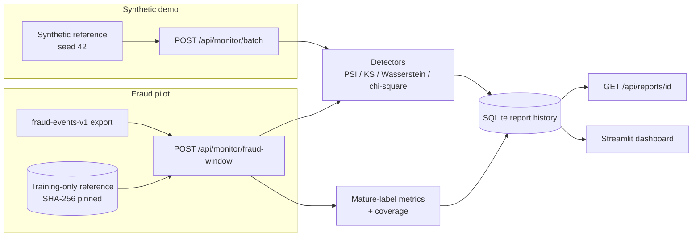

# Model Drift Monitoring Platform

[](https://github.com/sachin2967/model-monitoring-drift-platform/actions/workflows/ci.yml)


Tabular drift monitoring (PSI, KS, Wasserstein, chi-square, missingness) with a
synthetic demonstration, and a separate fraud-pilot interface that monitors real
exported prediction cohorts against a versioned training-only reference.

> **Scope.** A portfolio prototype, not a production monitoring service. The
> demonstration experiment uses generated data and six designed scenarios. Feature
> drift is not model failure; performance monitoring needs reliable delayed labels.

## Highlights

- **Multiple detectors, reported separately:** quantile-binned PSI, two-sample KS,
  Wasserstein distance, categorical chi-square and missing-fraction checks, rolled up
  into a heuristic status (`HEALTHY`, `WARNING`, `CRITICAL_DRIFT`).
- **Feature drift is not conflated with model quality.** The fraud interface reports
  feature/score shift apart from mature-label metrics, with explicit label coverage and
  minimum-sample states (fewer than 25 mature labels gives an insufficient-data result;
  single-class cohorts publish no ROC-AUC or AP).
- **Reference identity.** The fraud endpoint requires a training-only reference exported
  from the matching model, checked by SHA-256 in production mode. There is no synthetic
  fallback.
- **Input hygiene:** duplicate events, incompatible model/feature/policy versions and
  invalid label timestamps are rejected; batches are bounded (25-5,000 records).
- **Persistent reports** retrievable by ID, with operator-key authentication in
  production mode.

## Demonstration results

Seeded (42) synthetic experiment: a median-imputation + logistic-regression model
fitted on 4,000 rows, evaluated on six independent 1,000-row windows.

| Window | Scenario | Status | Max PSI | F1 | ROC-AUC |
| --- | --- | --- | ---: | ---: | ---: |
| W1 | Stable baseline | HEALTHY | 0.011 | 0.704 | 0.747 |
| W2 | Mild covariate shift | WARNING | 0.268 | 0.778 | 0.777 |
| W3 | Severe covariate shift | WARNING | 1.630 | 0.837 | 0.802 |
| W4 | Concept drift (labels reversed for one cohort) | HEALTHY | 0.024 | 0.450 | 0.489 |
| W5 | Null spike (30% missing `freight_ratio`) | WARNING | 0.020 | 0.703 | 0.735 |
| W6 | Multi-feature drift | CRITICAL_DRIFT | 1.725 | 0.943 | 0.820 |

What this shows, and what it doesn't:

- **Concept drift (W4) produced no PSI alert** while F1 fell to 0.450. Input-drift checks
  alone do not catch every performance failure.
- **Covariate shift did not hurt the model here (W2, W3, W6).** Outcomes are regenerated
  from the same synthetic rule, so F1 rose. High PSI is not evidence of degradation.
- The six windows are designed cases, not random repetitions. Their Pearson correlations
  (PSI vs F1 0.759, PSI vs ROC-AUC 0.565) are descriptive only: no significance test,
  no causal claim, no lead-time claim.

## Architecture



See [docs/ARCHITECTURE.md](docs/ARCHITECTURE.md).

## Quickstart

Requires Python 3.11.

```bash
git clone https://github.com/sachin2967/model-monitoring-drift-platform.git
cd model-monitoring-drift-platform
python -m venv .venv && source .venv/bin/activate     # Windows: .\.venv\Scripts\Activate.ps1
pip install -r requirements.txt
make experiment   # regenerate drift_benchmark_report.json
make test         # lint + 28 tests
make api          # http://127.0.0.1:8030/docs
make dashboard    # Streamlit cockpit
```

Or with Docker: `docker compose up --build` (API and dashboard bind to loopback on
8030 and 8530).

## API

| Route | Purpose |
| --- | --- |
| `GET /live` | Process liveness |
| `GET /ready`, `/health` | Report history and reference configuration checks |
| `POST /api/monitor/batch` | Synthetic-reference demo; 25-5,000 records with the four monitored features |
| `POST /api/monitor/fraud-window` | Fraud cohort monitoring against the configured reference |
| `GET /api/reports/{report_id}` | Retrieve a persisted report |
| `GET /api/benchmark` | Synthetic benchmark report |

Production mode (`APP_ENV=production`) requires a 32+ character `DRIFT_API_KEY`, a
persistent `DRIFT_STATE_PATH`, `FRAUD_REFERENCE_PATH` and a trusted
`FRAUD_REFERENCE_SHA256`. Non-health routes require `X-API-Key`; bodies are capped at
4 MiB. See [docs/OPERATIONS.md](docs/OPERATIONS.md) and `.env.example`.

## Methods

PSI uses 10 quantile bins derived from the reference distribution. The code's
heuristic bands are PSI < 0.10 stable, 0.10-0.25 moderate and >= 0.25 significant;
the detector's flag threshold defaults to 0.20, with KS alpha 0.01. KS and Wasserstein
use non-missing values; missingness is reported separately. These thresholds are
operational heuristics that have not been calibrated on live traffic.

## Repository layout

| Path | Responsibility |
| --- | --- |
| `src/drift/detectors.py` | PSI, KS, Wasserstein, chi-square, status aggregation |
| `src/drift/fraud.py` | Fraud event schema, reference loading, cohort and label metrics |
| `src/drift/history.py` | SQLite report persistence |
| `src/drift/simulator.py`, `synthetic.py` | Synthetic data and drift injection |
| `src/drift/correlation.py` | Descriptive PSI-vs-metric correlations |
| `api/app.py` | FastAPI application |
| `streamlit_app/` | Synthetic dashboard plus **Fraud Pilot** page |
| `scripts/run_drift_experiments.py` | Reproducible synthetic experiment |
| `tests/` | 28 tests |
| `docs/` | Architecture, limits, operations |

## Limitations

See [docs/LIMITATIONS.md](docs/LIMITATIONS.md) for the full list. In short: synthetic
demo data, no inferential claims from six windows, thresholds uncalibrated, labels may be
selective, and tenant authorization, automated alert delivery, model promotion,
monitoring of the monitor and cloud load/availability evidence are not implemented.

## Related projects

[Fraud risk scoring](https://github.com/sachin2967/fraud-risk-scoring-pipeline) (produces
the exports and reference) ·
[Portfolio guide](https://github.com/sachin2967/ml-portfolio)

## License

MIT.
