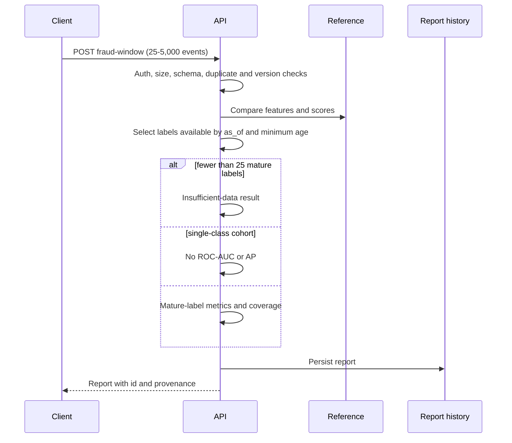

# Architecture

## Components

- **Detectors** (`src/drift/detectors.py`): per-feature PSI, KS, Wasserstein,
  chi-square for categoricals and missing fractions; an aggregator maps feature flags to
  `HEALTHY`, `WARNING` or `CRITICAL_DRIFT`. The mapping is a heuristic.
- **Synthetic demo path:** `POST /api/monitor/batch` compares a batch against a
  deterministic synthetic reference (4,000 rows, seed 42).
- **Fraud pilot path:** `POST /api/monitor/fraud-window` consumes `fraud-events-v1`
  exports. A cohort is rejected on duplicate events, mismatched model/feature/policy
  versions or invalid label timestamps.
- **Report history** (`src/drift/history.py`): every acknowledged fraud report is
  stored in SQLite and retrievable by ID.
- **Dashboard:** the default Streamlit page is synthetic; the Fraud Pilot page fetches
  persisted reports using server-side `DRIFT_API_URL` and `DRIFT_API_KEY`, never exposing
  the key to the browser.

## Fraud-window evaluation

Distribution diagnostics and label metrics are kept separate so a drift flag is never
read as proof of degraded performance (or the reverse).

## Trust boundaries

- The reference must come from the matching model's training partition; in production
  mode its SHA-256 is pinned.
- The operator key stays server-side and is not a multi-user identity system.
- Reference files are size-limited (10 MiB) and validated to 25-5,000 aligned rows.
